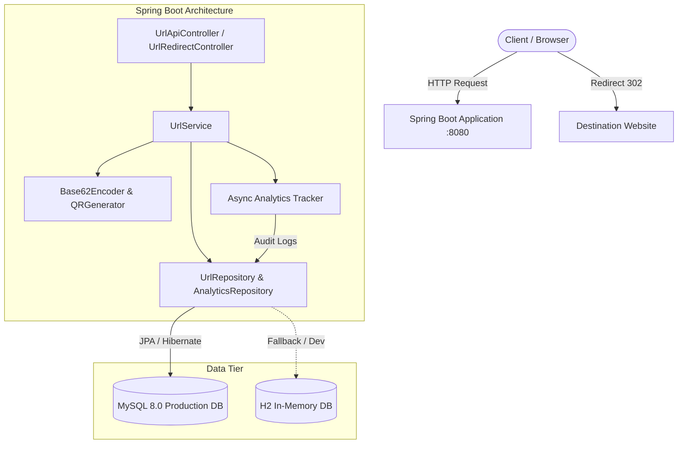
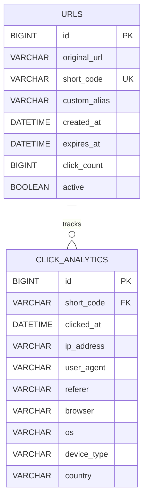

# 🚀 High-Performance URL Shortener & Analytics Service

[](https://openjdk.org/)
[](https://spring.io/projects/spring-boot)
[](https://www.mysql.com/)
[](https://www.docker.com/)
[](http://localhost:8080/swagger-ui.html)

A production-grade, enterprise-ready **URL Shortener Service** built with **Java (Spring Boot 3)** and **MySQL**. It features high-entropy Base62 encoding, custom branded vanity aliases, automated link expiration, instant QR Code generation, and clickstream analytics tracking devices, browsers, referrers, and daily visit trends visualized on an interactive web dashboard.

---

## ✨ Features

- **⚡ Blazing-Fast Redirection**: HTTP 302 Found redirects with low latency and async non-blocking click tracking.
- **🔗 Base62 URL Generation**: Generates 7-character high-entropy alphanumeric short codes with collision detection.
- **🏷️ Custom Vanity Aliases**: Allows users to specify customized slugs (e.g. `/summer-sale-2026`).
- **⏳ Link Expiration**: Optional expiration date (auto deactivates after target duration).
- **📊 Real-Time Clickstream Analytics**:
  - Total click volume and active link indicators.
  - Device distribution (Desktop, Mobile, Tablet).
  - Browser metrics (Chrome, Safari, Firefox, Edge, etc.).
  - Top traffic referrer domains.
  - Daily visit trends with interactive **Chart.js** charts.
  - Detailed visitor logs (IP, Browser, OS, Timestamp).
- **📱 Instant QR Code Engine**: Generates high-res PNG QR codes on-the-fly for every shortened link via ZXing.
- **🎨 Glassmorphic Web Dashboard**: Single-page modern UI to manage links, copy URLs, and inspect analytics visually.
- **📖 Interactive API Docs**: Full Swagger UI / OpenAPI 3.0 documentation out of the box.
- **🐳 1-Command Docker Deployment**: Complete multi-container orchestration with Spring Boot, MySQL 8, and phpMyAdmin.
- **🛡️ Resilient Architecture**: Supports production MySQL and zero-config H2 in-memory mode for instant dev testing.

---

## 🏛️ System Architecture



---

## 🗄️ Database Schema



---

## 🚀 Quick Start Guide

### Option 1: Run with Docker Compose (Recommended for Production)

Run the entire stack (Spring Boot + MySQL + phpMyAdmin) with a single command:

```bash
docker-compose up --build -d
```

- **Web Dashboard**: [http://localhost:8080](http://localhost:8080)
- **Swagger UI**: [http://localhost:8080/swagger-ui.html](http://localhost:8080/swagger-ui.html)
- **phpMyAdmin (DB Explorer)**: [http://localhost:8081](http://localhost:8081) (User: `root`, Password: `rootpassword`)

To stop:
```bash
docker-compose down
```

---

### Option 2: Run Locally with Maven (Zero-Config Dev Mode)

The application includes an embedded H2 database profile (`dev`), allowing you to run immediately without installing MySQL:

```bash
# Clone the repository
git clone https://github.com/your-username/url-shortener-service.git
cd url-shortener-service

# Build and run with Spring Boot (Dev Profile with H2)
mvn spring-boot:run
```

Access the app at [http://localhost:8080](http://localhost:8080) and the H2 Console at [http://localhost:8080/h2-console](http://localhost:8080/h2-console) (JDBC URL: `jdbc:h2:mem:urlshortener`).

---

### Option 3: Run Locally with Local MySQL

1. Create the MySQL database using `schema.sql`:
   ```bash
   mysql -u root -p < schema.sql
   ```
2. Run with the `prod` profile:
   ```bash
   mvn spring-boot:run -Dspring-boot.run.profiles=prod
   ```

---

## 📡 REST API Reference

### 1. Shorten a URL
- **POST** `/api/v1/urls/shorten`
- **Request Body**:
```json
{
  "originalUrl": "https://www.github.com/spring-projects/spring-boot",
  "customAlias": "spring-boot-repo",
  "expirationDays": 30
}
```
- **Response** (`201 Created`):
```json
{
  "success": true,
  "message": "Short URL created successfully",
  "data": {
    "originalUrl": "https://www.github.com/spring-projects/spring-boot",
    "shortUrl": "http://localhost:8080/spring-boot-repo",
    "shortCode": "spring-boot-repo",
    "qrCodeUrl": "http://localhost:8080/api/v1/urls/spring-boot-repo/qr",
    "createdAt": "2026-11-13T19:00:00",
    "expiresAt": "2026-12-13T19:00:00",
    "clickCount": 0
  },
  "timestamp": "2026-11-13T19:00:00"
}
```

### 2. Redirect to Original URL
- **GET** `/{shortCode}`
- **Response**: `302 Found` with `Location: <original_url>` header. Automatically records click analytics in the background.

### 3. Get Clickstream Analytics
- **GET** `/api/v1/urls/{shortCode}/analytics`
- **Response** (`200 OK`):
```json
{
  "success": true,
  "data": {
    "shortCode": "spring-boot-repo",
    "originalUrl": "https://www.github.com/spring-projects/spring-boot",
    "shortUrl": "http://localhost:8080/spring-boot-repo",
    "totalClicks": 128,
    "deviceBreakdown": { "Desktop": 82, "Mobile": 46 },
    "browserBreakdown": { "Google Chrome": 74, "Safari": 32, "Mozilla Firefox": 22 },
    "refererBreakdown": { "Direct": 90, "https://t.co": 38 },
    "clicksByDate": { "2026-11-10": 12, "2026-11-11": 34, "2026-11-12": 82 },
    "recentClicks": [
      {
        "timestamp": "2026-11-13T19:15:22",
        "ipAddress": "192.168.1.1",
        "browser": "Google Chrome",
        "os": "Windows",
        "deviceType": "Desktop",
        "referer": "Direct",
        "country": "Unknown"
      }
    ]
  }
}
```

### 4. Fetch QR Code
- **GET** `/api/v1/urls/{shortCode}/qr?size=300`
- Returns an image file (`image/png`).

### 5. System Overview Statistics
- **GET** `/api/v1/urls/stats/overview`
- **Response** (`200 OK`):
```json
{
  "success": true,
  "data": {
    "totalUrls": 1500,
    "totalClicks": 45210,
    "activeUrls": 1485
  }
}
```

### 6. Delete Short URL
- **DELETE** `/api/v1/urls/{shortCode}`
- **Response**: `200 OK`

---

## 🧪 Testing

Execute automated unit and integration tests:

```bash
mvn test
```

---

## 🛠️ Tech Stack

| Layer | Technology |
|---|---|
| **Backend** | Java 17, Spring Boot 3.2.5, Spring Data JPA, Spring Web |
| **Database** | MySQL 8.0 (Production), H2 Database (Development fallback) |
| **API Documentation** | Springdoc OpenAPI 3.0 / Swagger UI |
| **QR Generation** | ZXing Core & JavaSE 3.5.3 |
| **Containerization** | Docker, Docker Compose (Multi-stage build) |
| **Frontend** | Vanilla JS, Modern CSS (Glassmorphism), Chart.js, FontAwesome |

---

## 📄 License

This project is licensed under the MIT License.

